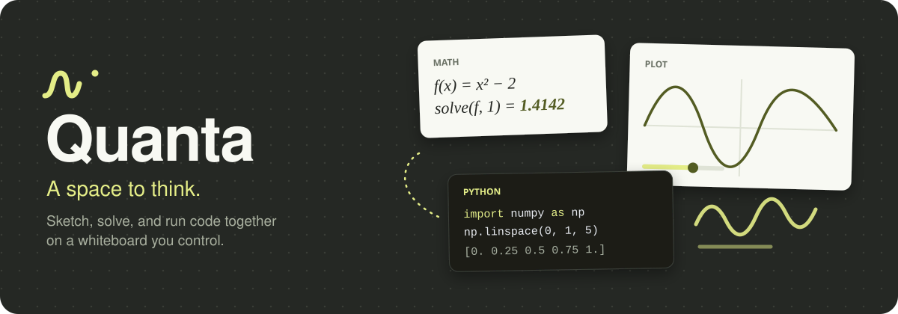
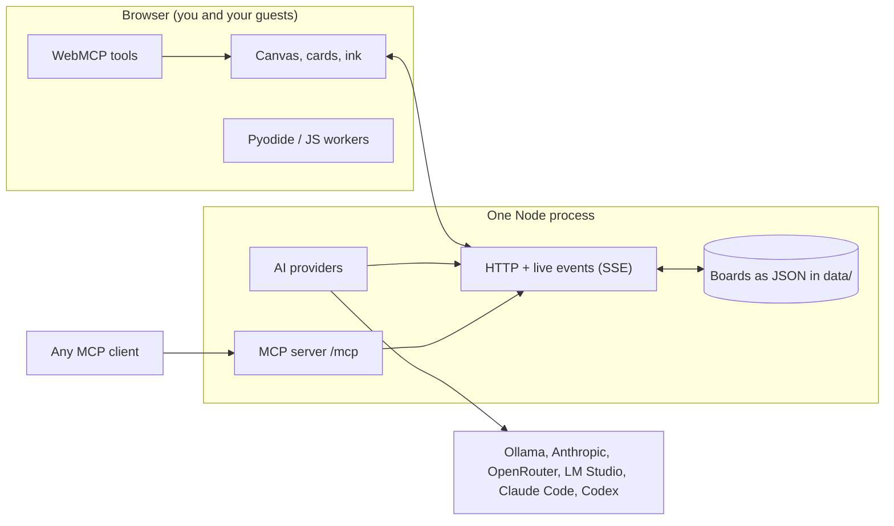

<div align="center">



<br>

[](https://github.com/real-kijmoshi/quanta/releases/latest)
[](LICENSE)
[](https://nodejs.org)
[](docs/SELF_HOSTING.md)
[](#mcp-and-webmcp)

**[Website](https://real-kijmoshi.github.io/quanta/)** · **[Download](https://github.com/real-kijmoshi/quanta/releases/latest)** · **[Self-hosting](docs/SELF_HOSTING.md)** · **[Changelog](CHANGELOG.md)** · **[Contributing](CONTRIBUTING.md)**

</div>

Quanta is a self-hosted whiteboard and notebook for maths, physics, and code. Write by hand, typeset equations, plot functions, run Python and JavaScript, and work live with other people, all on one infinite canvas. Boards are plain JSON files on your disk, and a single Node process owns the workspace. There is no cloud account to create and no lock-in.

## Highlights

- **Handwriting that feels right.** Pressure-aware pens, shape snapping, palm rejection, a highlighter, and a precise eraser.
- **Maths and physics built in.** Cards evaluate and typeset each line, with units-friendly constants, vectors, integrals, derivatives, solvers, and live plots with sliders.
- **Runnable code.** JavaScript in a browser worker; Python on the host, or in each guest's browser via Pyodide (numpy, sympy, matplotlib).
- **Real-time collaboration.** Live cursors, ink as it's written, follow mode, comments, and offline edits that merge when you reconnect.
- **Folders with invitations.** Share a folder with a revocable link per person. Optional hosted mode adds accounts for an always-on team workspace.
- **AI that edits the board.** Ollama, Anthropic, OpenRouter, LM Studio, Claude Code, and Codex, plus an MCP server so any MCP client can read and edit boards.
- **Notebooks and PDFs.** A4 pages, PDF import you can write on, print to PDF, and an optional Notes beta with flashcards and audio notes.

## Quick start

Requires [Node.js 22+](https://nodejs.org). The installers verify a SHA-256 checksum before installing.

```sh
# macOS / Linux
curl -fsSL https://github.com/real-kijmoshi/quanta/releases/latest/download/install.sh | sh
```

```powershell
# Windows (PowerShell)
irm https://github.com/real-kijmoshi/quanta/releases/latest/download/install.ps1 | iex
```

```sh
quanta                  # starts in the background, opens http://localhost:4173
quanta --tunnel         # same, plus a public link (cloudflared is fetched if missing)
```

Update with `quanta update`; your boards are not touched.

<details>
<summary>Other ways to install</summary>

- **npm:** `npm install -g <release>/quanta.tgz`
- **Docker:** `ghcr.io/real-kijmoshi/quanta` (runs in account mode; see the [self-hosting guide](docs/SELF_HOSTING.md))
- **From a clone:**

  ```sh
  npm ci --ignore-scripts
  npm start            # just you:             http://localhost:4173
  npm run share        # everyone on your LAN: prints http://<your-ip>:4173
  npm run tunnel       # over the internet:    prints an owner link and a public URL
  ```

</details>

### Command line

| Command | Purpose |
|---|---|
| `quanta [--tunnel|--share] [--port N] [--data DIR]` | Start in the background and open the terminal dashboard: live status and links, switch local/share/tunnel with ←→, copy the link, logs, settings and updates. Quitting leaves Quanta running |
| `quanta ui` | Open the dashboard without starting anything (`--no-ui` prints the links and exits instead) |
| `quanta stop` / `restart` / `status` / `logs [-f]` / `open` | Manage the background workspace from scripts |
| `quanta update [--check]` | Install the latest release; boards are kept and a running workspace restarts |
| `quanta config mode tunnel` | Make the tunnel (or `share`, `local`) the default for plain `quanta` |
| `quanta --foreground` | Run attached to the terminal; Ctrl+C stops it |
| `quanta setup` | Interactive Linux server setup with accounts and HTTPS |
| `quanta backup [dir]` / `backup --verify <dir>` | Verified backups |
| `quanta reset-password <email>` | Hosted mode account recovery |
| `quanta doctor` | Diagnose the install |

Run `quanta --help` for everything else. See [local release and recovery](docs/LOCAL_RELEASE.md) for backup, restore, and operating limits.

## Shortcuts

| Key | Tool | Key | Tool |
|---|---|---|---|
| `V` | Select | `F` | Math card |
| `P` | Pen | `Y` | Plot card |
| `M` | Marker | `C` | Code card |
| `E` | Eraser | `N` | Note |
| `L` | Lasso | `A` | Connector |
| `K` | Comment | `[` `]` | Tool size |
| `Shift+G` | Pages | `Shift+P` | Present frames |
| `Shift+A` | Assistant | `Ctrl+K` | Search & commands |
| `Ctrl+P` | Print / save as PDF | | |

## Features

### Handwriting

- **Pen** is a smooth, even line by default. Switch to **Fountain** (tapered, follows stylus pressure) or **Brush**. Mouse and touch jitter is filtered, and stylus pressure plus coalesced and predicted pointer events are used when available.
- **Draw a shape and hold still** to snap it to a clean line, arrow, circle, ellipse, triangle, rectangle, or polygon.
- **Marker** is a highlighter that multiplies under ink and text, like a real one.
- **Eraser** removes whole strokes or cuts them precisely. A stylus barrel button erases too.
- **Lasso** circles ink *and* cards; drag to move, drag a corner to scale, recolour, duplicate, or delete.
- **Palm rejection:** with a stylus, fingers pan and two fingers pinch-zoom. Turn on "Finger draws" to draw with a finger.

### Maths, physics, and code

- **Text and notes** understand Markdown (headings, lists, `- [ ]` checkboxes, `code`) and LaTeX: `$e^{i\pi}+1=0$`, `$$\int_0^1 x^2\,dx$$`.
- **Math cards** evaluate and typeset each line: variables, implicit multiplication (`2 pi r`), `f(x) = x^2` definitions, vectors (`[1,2,3]`, `cross`, `dot`, `norm`), `integrate(f, 0, 1)`, `deriv(f, 2)`, `solve(f, 1)`, and constants (`g`, `c`, `G`, `h`, `hbar`, `k_B`, `N_A`, `q_e`, `m_e`, …).
- **Plot cards** take `f(x) = sin(a x)`, `y = x^2`, parametric `(cos(t), sin(2t))`, points `(1, 2)`, and ranges `x: -5..5`. Number-only lines like `a = 2` get a slider.
- **Code cards** run JavaScript in a browser worker. Python runs on the host machine for the host, and in each guest's browser via Pyodide, with numpy, sympy, and matplotlib loaded on demand. The last expression's value is shown and matplotlib figures appear in the card.
- **Connectors** are drawn from one card to another and stay attached as cards move.

### Notebooks and PDFs

- **Pages** are A4 with blank, ruled, grid, dots, or graph paper. Add them from the Pages panel or the board menu.
- **Import PDF** by dropping one on the board. Each page becomes a locked page you can write on.
- **Print / save as PDF** prints every page (or every frame) one per sheet, ink included.
- **Notes beta** is an optional PC/iPad notebook interface with a library, page thumbnails and bookmarks, seven paper styles, page duplication and reordering, PDF text search, favourite pens, audio notes, flashcards with spaced review, and portable notebook backups. Enable it in **Workspace settings → Notes**. See [Notes beta features and limits](docs/NOTES_BETA.md).

### Working together

- **Live sync** of every card, stroke, and comment, with collaborators' cursors, ink while they write, and selections shown in their colour. Click an avatar to **follow their view**.
- **Conflict handling:** undo only undoes *your* changes; concurrent edits merge per object (newest wins), deletes are kept as tombstones, and offline edits sync on reconnect.
- **Folders and subfolders** can be nested, and boards or folders dragged between them. Deleting a folder keeps its boards in the parent.
- **Related boards:** connect boards with Links and navigate between them. Connections are bidirectional and survive restarts.
- **Overview and search** find cards and frames on a board; `Ctrl+K` opens the command palette. Stars are saved per browser.
- **Templates:** Notebook, Math notebook, Physics problem, Coding session, Sprint planning, and Team retrospective.
- **Presentation mode** (`Shift+P`) steps through frames; **comments** (`K`) attach to the board.

#### Sharing

Open localhost on the host computer to manage your workspace. Share a folder from its actions menu, create a separate named invitation per person, copy the link, and revoke any invitation at any time. Access covers every board and subfolder, including future ones.

> [!NOTE]
> Invitation names are labels, not verified accounts: anyone holding a link can use it. The link is shown once, only invitation hashes are stored on disk, and accepted invitations use an HttpOnly cookie.

Guests can create, edit, and link boards inside their folder. Folder management, invitations, deletion, trash, host Python, AI, and MCP stay owner-only. Folder scope is enforced for board reads and writes, search, assets, and live events. Revoking an invitation disconnects active streams and rejects further requests, though copies already downloaded cannot be recalled.

`npm run share` binds to all network interfaces. `npm run tunnel` shares over HTTPS and prints two URLs:

- **Owner URL:** private. Open it once to keep owner access through the tunnel.
- **Public URL:** put this in the sharing dialog's server address for invitees.

> [!WARNING]
> Never share the Owner URL. Anyone who opens it becomes the workspace owner.

## AI and agents

Open the **Assistant panel** (`Shift+A`), choose a provider and model, and ask it to read, add, update, or delete cards. Every provider uses the same validated tools. Provider and model choices are remembered per browser, and Stop cancels the request (edits already made stay).

| Provider | Setup |
|---|---|
| **Ollama** | Start Ollama and pull a tool-capable model. Refresh discovers installed models. Runs on your machine. |
| **Claude Code / Codex** | Install the CLI and sign in first (`claude auth login` or `codex login`). Quanta runs it in a temporary directory with built-in tools and MCP servers disabled (Claude) or a read-only sandbox (Codex). The CLI returns structured board actions that Quanta validates and executes. |
| **Anthropic** | Set `ANTHROPIC_API_KEY` or `ANTHROPIC_AUTH_TOKEN` and restart. Enter any tool-capable model ID; `QUANTA_MODEL` sets the default. |
| **OpenRouter** | Set `OPENROUTER_API_KEY` and restart. Refresh lists models with tool support, or type a model ID. |
| **Compatible API / LM Studio** | Start LM Studio's local server, or set `QUANTA_COMPATIBLE_URL` (and optionally `QUANTA_COMPATIBLE_KEY`) for another Chat Completions-compatible service. |

Credentials live in server environment variables and are never sent to the browser. Local model servers and terminal providers are available only from localhost on the host machine, and assistant providers are available to the workspace owner. CLI providers may still use the vendor's cloud for inference.

### MCP and WebMCP

- **MCP server** at `http://localhost:4173/mcp` (Streamable HTTP). List, read, create, and edit boards from any MCP client; changes appear live in open tabs.
- **WebMCP** registers 11 tools when the browser supports `document.modelContext` (with a legacy `navigator.modelContext` fallback): read, add, update, delete, and search cards; read the selection; run a specified code card; focus a card; fit the board; undo; and redo. Inputs are validated, outputs are JSON strings, and registration status shows in the Assistant panel. Browsers without support can use the HTTP MCP server. WebMCP is a board-control interface, not a web-search service.

## Always-on hosting

Run this on a Debian or Ubuntu VPS with your domain pointing at it:

```sh
curl -fsSL https://github.com/real-kijmoshi/quanta/releases/latest/download/setup-server.sh | bash
```

The wizard asks for your domain and owner email, installs Docker if needed, downloads the published images, and starts your workspace with automatic HTTPS. No checkout or Node.js installation needed. If Quanta is already installed, run `quanta setup` instead. Server administration may prompt for your system password.

Hosted mode adds personal accounts, persistent sessions, email-bound folder invitations, and membership across multiple folders. Invitations are copied and sent manually. The [self-hosting guide](docs/SELF_HOSTING.md) covers setup, updates, backups, and password recovery.

## Configuration

Set these as environment variables. Everything is optional for local use.

| Variable | Default | Purpose |
|---|---|---|
| `PORT` | `4173` | HTTP port |
| `HOST` | `127.0.0.1` (`0.0.0.0` with `npm run share`) | Bind address |
| `QUANTA_DATA` | `./data` | Where boards and uploaded files are stored |
| `QUANTA_ALLOWED_HOSTS` | unset | Additional trusted Host header names, comma-separated |
| `QUANTA_REMOTE_RUN` | unset | Legacy runtime setting; folder guests always run Python in-browser |
| `QUANTA_RUN_TIMEOUT` | `20000` | Host code-run timeout in ms |
| `QUANTA_AI_PROVIDER` | first available | Preferred provider: `anthropic`, `ollama`, `claude-code`, `codex`, `openrouter`, `compatible` |
| `QUANTA_AI_TIMEOUT` | `180000` | Provider/terminal timeout in ms |
| `QUANTA_MODEL` | first discovered | Default Anthropic model (manual ID if catalog unavailable) |
| `ANTHROPIC_API_KEY` / `ANTHROPIC_AUTH_TOKEN` | unset | Anthropic credential, server only |
| `OLLAMA_HOST` | `http://127.0.0.1:11434` | Ollama server URL, including protocol |
| `QUANTA_OLLAMA_MODEL` | first installed | Default Ollama model |
| `OPENROUTER_API_KEY` | unset | OpenRouter credential, server only |
| `QUANTA_OPENROUTER_MODEL` | `openrouter/auto` | Default OpenRouter model |
| `QUANTA_COMPATIBLE_URL` | `http://127.0.0.1:1234/v1` | Compatible API base URL |
| `QUANTA_COMPATIBLE_KEY` | unset | Optional compatible API credential |
| `QUANTA_COMPATIBLE_MODEL` | first discovered | Default compatible model |
| `QUANTA_CLAUDE_BIN` / `QUANTA_CODEX_BIN` | auto-detected from PATH | Absolute CLI executable or npm shim path |
| `QUANTA_CLAUDE_CODE_MODEL` / `QUANTA_CODEX_MODEL` | CLI default | Terminal model override |

## Development

```sh
npm ci --ignore-scripts
npm start
npm test
```

| Script | Checks |
|---|---|
| `npm test` | Everything below: syntax, rendering, storage, recovery, collaboration, folders, hosted mode, mocked AI providers, and the CLI |
| `npm run check` | Syntax-checks every source file |
| `npm run test:performance` | Retained ink, pan cache invalidation, pointer coalescing, connector updates, low-zoom pen rendering |
| `npm run test:collaboration` | Distinct tab identities, ordered and bounded presence on slow connections, live ink retry, board-switch isolation, SSE backpressure |
| `npm run test:ai` | Mock provider tool loops, CLI subprocesses, cancellation, access controls, model discovery, WebMCP validation, with no paid inference or changes to your boards |

Slow SSE viewers are disconnected once pending output exceeds 1 MiB and recover through the normal snapshot reconnect flow.

### Profiling in the browser

Open `http://127.0.0.1:4173/diagnostics/canvas-profile.html` and click **Run profile**, keeping the tab in the foreground until it finishes. It uses an in-memory 2,000-stroke board, so saved boards are untouched, and reports pan frame intervals, CPU submission times, and stroke submissions. **Run live ink at 5% zoom** exercises the real live preview with coalesced samples and reports raster surface size, cleared area, idle frame intervals, and input-to-next-frame intervals.

Frame intervals depend on browser scheduling and other activity, and CPU timings exclude deferred GPU rasterization. Runs flagged with scheduling interruptions are unsuitable for latency comparisons.

## How it works



The server stores each board as a plain JSON file and streams changes to open tabs. Browsers do the rendering, maths, and guest code execution, so the host stays light. The AI assistant and MCP clients go through the same validated board tools, so an agent can never do more than a person at the canvas.

## FAQ

<details>
<summary><b>Do I need an account or an internet connection?</b></summary>

No. Local mode has no accounts and works offline. Only AI providers that call a cloud API, the Cloudflare tunnel, and on-demand Pyodide packages need a connection. Hosted mode adds accounts for team servers.
</details>

<details>
<summary><b>Where are my boards stored, and how do I back them up?</b></summary>

As plain JSON files in `~/.quanta/data` (or `./data` from a clone, or `QUANTA_DATA`). Run `quanta backup [dir]` for a verified copy and `quanta backup --verify <dir>` to check one. See [local release and recovery](docs/LOCAL_RELEASE.md).
</details>

<details>
<summary><b>Is it safe to run other people's code?</b></summary>

Guests run Python in their own browser via Pyodide, and JavaScript in a browser worker. Host Python, AI, and MCP are owner-only.
</details>

<details>
<summary><b>Can I use it on an iPad or with a stylus?</b></summary>

Yes. Pressure, coalesced and predicted pointer events, barrel-button erase, and palm rejection are supported where the browser exposes them. The optional Notes beta is built for PC and iPad.
</details>

<details>
<summary><b>Can my own AI agent edit a board?</b></summary>

Yes. Point any MCP client at `http://localhost:4173/mcp`, or use the Assistant panel with a provider of your choice. Changes appear live in open tabs.
</details>

<details>
<summary><b>Something broke. Where do I start?</b></summary>

Run `quanta doctor`, then check [local release and recovery](docs/LOCAL_RELEASE.md). If it's still broken, [open an issue](https://github.com/real-kijmoshi/quanta/issues/new/choose).
</details>

## Contributing and security

Issues and pull requests are welcome; start with [CONTRIBUTING.md](CONTRIBUTING.md). To report a vulnerability, follow [SECURITY.md](SECURITY.md) instead of opening a public issue.

## License

[MIT](LICENSE)
